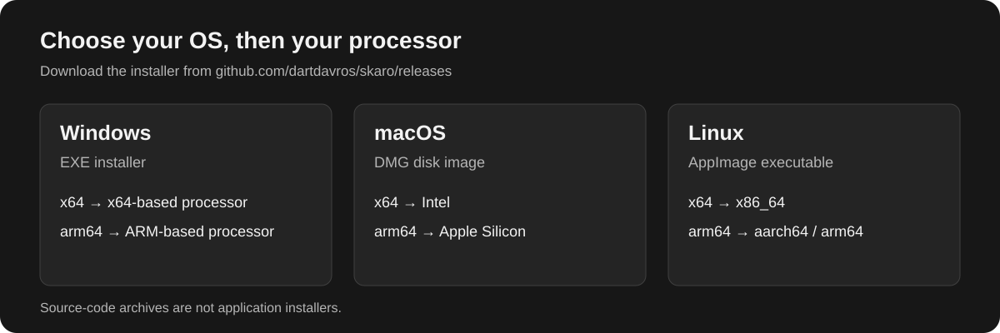
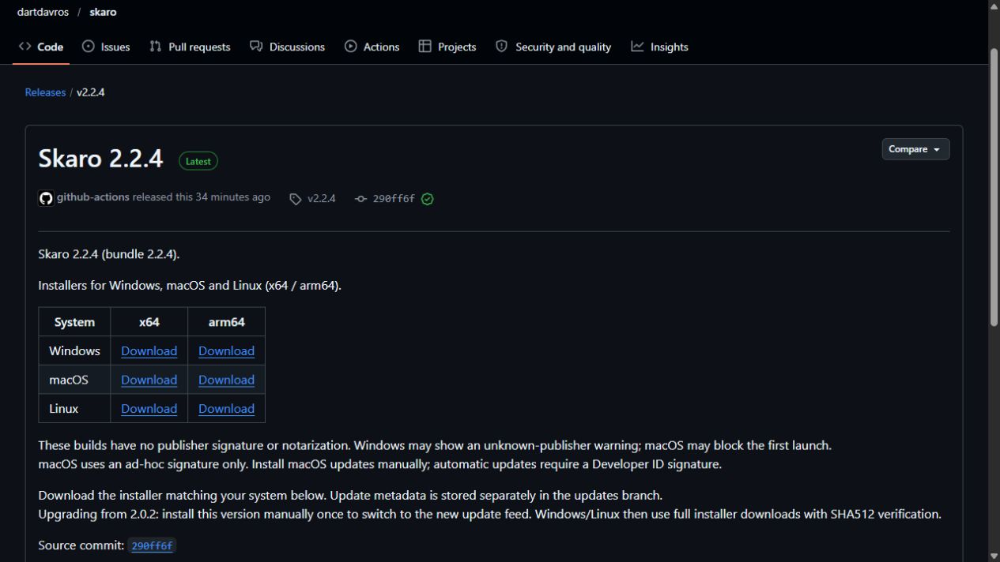
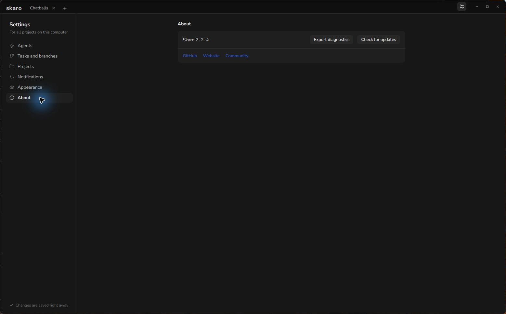

# Install Skaro on Windows

Download the Windows installer, choose the build for your processor and open Skaro. Current releases do not have a publisher code-signing certificate, so Windows or your browser may show a warning.

## 1. Choose x64 or ARM64

Open **Windows Settings → System → About** and check **System type**. Choose **x64** for an x64-based processor and **arm64** for an ARM-based processor. Do not choose the ARM build just because your computer runs 64-bit Windows.

## 2. Download from the official release

Open the [latest Skaro release on GitHub](https://github.com/dartdavros/skaro/releases/latest). In its download table, select **Windows** and the architecture from the previous step. The filename ends in `win-x64.exe` or `win-arm64.exe`.

Use the installer from the official `dartdavros/skaro` repository. **Source code** ZIP and TAR archives are not installers.

## 3. Handle an unsigned-app warning

If the browser flags the file as uncommon or potentially unsafe, check the source and filename before choosing to keep it. Browser wording varies. Do not continue if the download is from another site or your antivirus reports an actual threat.

Open the downloaded EXE. If Windows displays **Windows protected your PC** for this installer:

1. Check that you deliberately downloaded Skaro from the official release.
2. Click **More info**.
3. If **Run anyway** is offered and you choose to trust the file, click it to continue.

The publisher can appear as **Unknown publisher** because Skaro is unsigned. If Windows asks for permission to continue, verify the installer name before approving it yourself. On managed computers, organizational policy may prevent installation or omit **Run anyway**; contact your administrator in that case.

These steps allow this particular installer to run. You do not need to turn off Microsoft Defender or SmartScreen globally. An unsigned-publisher warning does not prove that a file is safe, and a checksum does not replace a publisher signature.

Microsoft documents SmartScreen prompts in its [Windows app distribution guide](https://learn.microsoft.com/en-us/windows/apps/package-and-deploy/publish-first-app).

## 4. Open Skaro

Let the installer finish, then launch **Skaro** from the Start menu or its installed shortcut. Open **Settings → About** to see the installed version. The screenshot below shows the actual installed Windows application, not an installation wizard.

Select English under **Settings → Appearance** if needed. Next, [connect Codex or Claude Code](/articles/connect-agents), then [open your first project](/articles/start-here).

## If installation is blocked

Check the architecture and download source first. For an incomplete download, download the installer again. A malware detection, a company policy block and an unknown-publisher prompt are different problems: do not apply the SmartScreen steps indiscriminately to all three.

See [Troubleshoot Common Problems](/articles/troubleshooting) for the information to include when asking for help.
