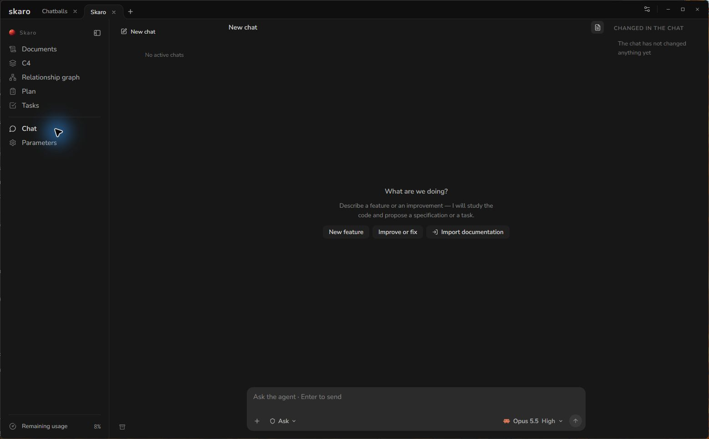
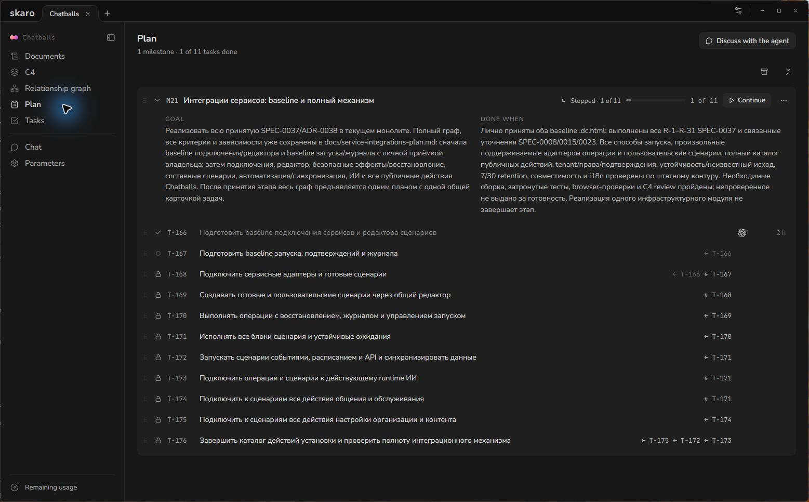

# Plan Your Work with Project Chat

Use project **Chat** to discuss goals, inspect an existing codebase and prepare a manageable plan. **Plan** and **Tasks** show the accepted work; a chat proposal is something to review, not a reason to skip checking its scope.

## Describe the result

Open a project and choose **Chat**. State what you want to achieve, constraints the agent must respect and what success looks like. Ask for inspection before changes when you only want advice.

For example:

> Inspect the current onboarding flow. Propose the smallest useful plan to make the installation instructions clearer. Preserve the interface and do not implement anything yet. Include acceptance criteria and the checks needed for each task.

This is a suggested prompt. It is not an example of a completed run.

## Review the proposed work

Check that the plan covers the intended result without unrelated work. Ask the agent to revise unclear acceptance criteria, missing dependencies or tasks that split one small result into many separate runs.

For substantial new functionality, a specification can describe the behavior before implementation. A small fix can be a single task without a milestone or a long planning process. Existing projects do not need their entire documentation rewritten first.

When Skaro presents a plan for confirmation, review its milestones, tasks and dependencies. Accept the work you want, or ask the agent to revise it. Do not interpret a conversational suggestion as proof that the tasks have already been created; check **Plan** or **Tasks** afterward.

## Read the plan

**Plan** groups tasks into milestones and shows their order. A milestone organizes work; it is not one shared execution session or one shared task branch.

Project-authored names in this screenshot are in their original language. The application controls are in English.

Dependencies determine which tasks can start. A task waiting for a dependency remains blocked until the required work is done and merged, unless you explicitly change or override the dependency.

## Keep instructions close to the project

Use **Documents** for the brief, architecture, decisions, specifications and other project context. State requirements and restrictions explicitly instead of relying only on an old conversation. Skaro stores project artifacts in `.skaro/` beside the code.

The chat's selected permissions matter. Review them before sending a request that could change files. Asking for a plan and giving an agent broad access are separate decisions.

When the plan is ready, [run a task](/articles/run-tasks). After the task finishes, [review and merge its result](/articles/review-and-merge).
