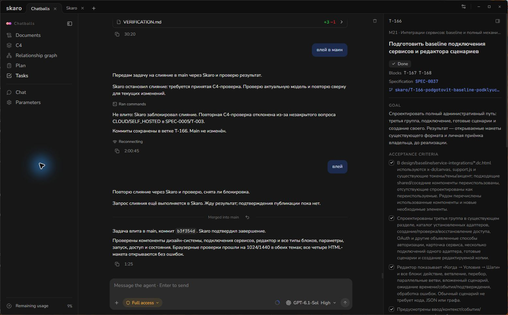

# Review and Merge Task Changes

A completed agent reply is not, by itself, proof that the intended files were changed or that the required checks passed. Read the result, inspect the changes and check how Skaro is configured to merge tasks.

## Decide whether merging is automatic

Open **Settings → Tasks and branches** and inspect **Merge automatically when the criteria are met**. Turn it off before running work if you want completed tasks to wait for a merge confirmation card. With it enabled, Skaro can commit and merge accepted task results automatically.

This is independent of the agent's permission mode. Permission to run commands and the choice to merge a result are different settings.

## Inspect the result

Open the task's conversation and review its final reply, changed files and acceptance criteria. Check what was actually verified. If a backend or another required service was unavailable, that limitation should be explicit; it is not a passed runtime check.

If something is missing, send a specific follow-up in the same task. Describe the desired correction and the relevant acceptance criteria before asking the agent to finish again.

The screenshot below shows the real task conversation and its description area. It is an existing task, not a staged demonstration of a new merge.

## Merge a task branch

With automatic merging off, completed work can wait **In review** with a confirmation card in that task's feed. Inspect the card and confirm the merge when you are satisfied.

An explicit request to merge can also authorize the operation. Do not assume that asking the agent to merge will always lead to a second confirmation prompt.

Skaro merges tasks one at a time into the configured base branch. Dependencies must be merged first. The configured merge method can be Squash, Merge or Rebase. Project checks run if they have been configured; a clean Git merge does not mean that every possible test has run.

A task that ran in **Current folder** already edited the main working folder and does not need a separate task-branch merge.

## If merging is blocked

- **Local changes overlap:** inspect the paths Skaro lists. Commit, move or otherwise resolve your changes deliberately before retrying. Do not discard unrelated work just to clear the warning.
- **A project check fails:** read its output and correct the cause in the task.
- **A branch conflict occurs:** Skaro can return the task to its agent to bring in the base branch, resolve the conflict and verify the affected behavior before submitting the result again.
- **A dependency is unfinished:** finish and merge the dependency first.

## Undoing a merge

Where the task's merged-result line offers **Revert merge**, it creates a Git commit reversing the merge and returns the task for review. It is not a silent deletion of Git history. Review the confirmation and any conflict before proceeding.

Keep using the task conversation for follow-up work so the agent has the relevant context. For a new independent result, create a new task instead.
