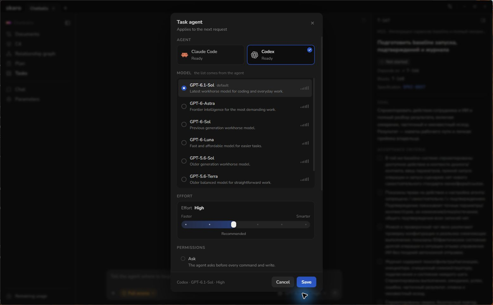
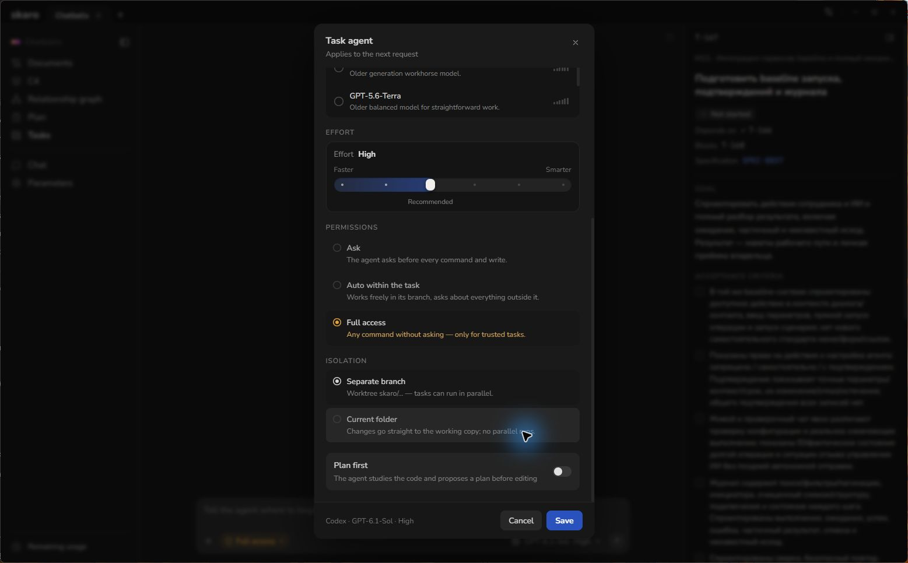
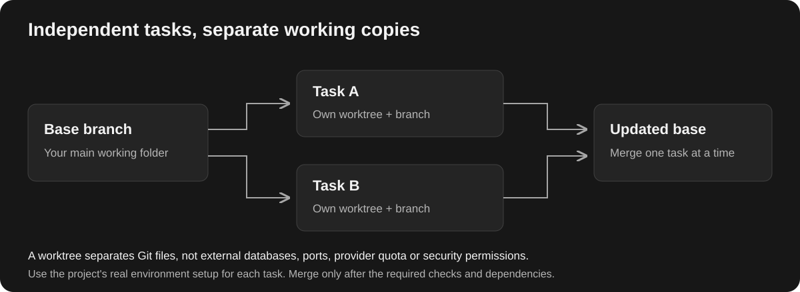

# Run Tasks and Work with Agents

Open **Tasks** in a project to see its board or list. Select a task, check what it asks for and start the agent when its scope and execution settings are correct.

The project content in this screenshot is in its original language. The interface is set to English.

## Before you start

Read the description, acceptance criteria and dependencies. Confirm that the selected agent is ready. Check that the project's real tools and services are available; Skaro does not make an absent backend or dependency disappear.

Inspect the task's agent settings before clicking **Start**:

- **Agent, model and effort:** select the connected agent and a model suited to the job. Available effort levels depend on the model.
- **Permissions:** **Ask** requests approval for actions as required by the agent; **Auto within the task** permits actions within the agent's supported task restrictions; **Full access** allows broader access. Read any sandbox warning shown by Skaro. A permission label is not a guarantee that every platform supports the same sandbox.
- **Isolation:** **Separate branch** gives the task a Git worktree. **Current folder** runs directly in the main working folder, so file changes happen there immediately.
- **Plan first:** use it when you want the agent to prepare its approach before implementation.

The selected values belong to the existing task shown here. Choose your own permissions deliberately rather than copying the screenshot's Full access setting.

## Follow the feed

Start the task and watch its feed for progress, action groups, commands and replies. Expand a group or command output when you need details. Answer questions and permission requests in the task itself.

You can send a follow-up to clarify requirements. Use the task's stop action if you need to halt execution; stopping a task does not undo files already changed. Inspect the result before continuing or starting another attempt.

## Run independent tasks in parallel

Use separate worktrees for tasks that can run independently. They have separate working folders and branches, so one task's edits do not automatically appear in another task's checkout.

**Settings → Tasks and branches → Parallel runs** limits simultaneous runs. Additional work may wait in a queue. A dependency block and a capacity queue are different reasons for a task to wait.

Parallel runs can still share external services or resources. A Git worktree does not isolate databases, ports or provider quota by itself. Use the project's documented environment setup.

## Understand the outcome

- **Needs an answer:** the agent needs input, approval or further direction.
- **Failed:** inspect the error and existing changes before retrying.
- **In review:** review the result and the merge confirmation in the task feed.
- **Done:** the task has completed; for a separate task branch this normally follows merging. With automatic merging enabled, it may skip the manual review step.

See [Review and Merge Task Changes](/articles/review-and-merge). For sign-in, quota or environment problems, see [Troubleshoot Common Problems](/articles/troubleshooting).
