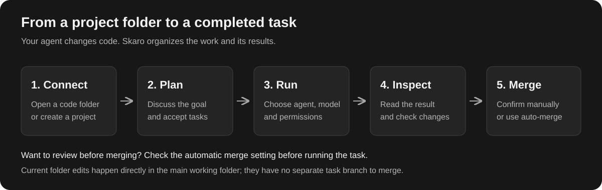
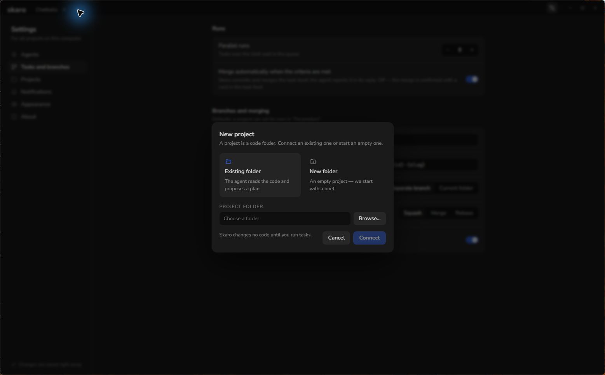
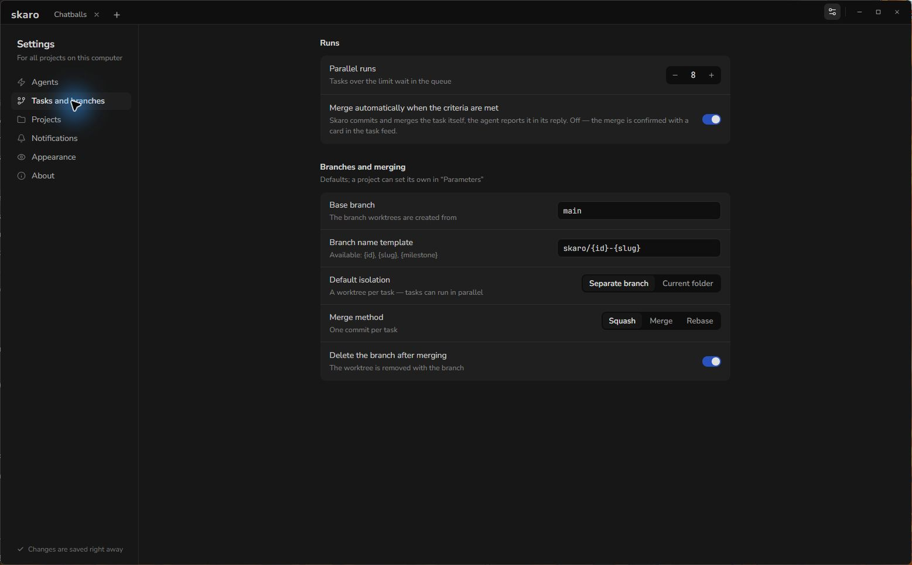
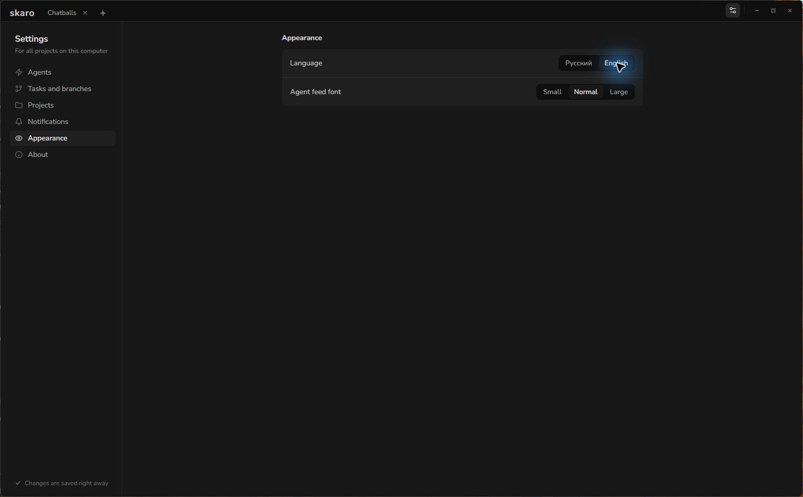

# Start Here: Your First Project in Skaro

Skaro is a local desktop workspace for development with Codex and Claude Code. The agents read and change code; Skaro organizes projects, documents, plans, tasks and their results. You use your own agent account. A separate Skaro account is not required.

## Before you start

- Install Skaro for [Windows](/articles/install-windows), [macOS](/articles/install-macos) or [Linux](/articles/install-linux).
- [Connect at least one agent](/articles/connect-agents) with an account that can use it.
- Have Git available on your computer for task branches and merging. Your project's own tools and services are still needed to build and test its code.

## 1. Open a project

Click **New project** on the Projects screen, or the **+** button in the top bar.

Choose **Existing folder** to connect code you already have. Click **Browse…**, select the project root and click **Connect**. Select the folder containing the repository, rather than a parent folder containing several projects.

Choose **New folder** to start a project. Select where to create it, enter its name and click **Create project**. Skaro creates the folder and initializes a Git repository.

A folder without Git can be connected, but task branches and merging are unavailable. Skaro shows this before you connect it.

## 2. Give the agent a clear goal

Open **Chat** in the project sidebar. Describe the result you want, any constraints and how you will check success. For example:

> Inspect this repository and propose a task to improve its installation instructions. Do not change files yet. Include acceptance criteria and tell me which checks are needed.

This is a prompt you can use, not a recorded agent response. Review what the agent proposes before accepting it. Existing projects do not need a complete new brief or architecture document just to make a small change.

## 3. Start one task

Open **Tasks**, select a task and check its description and acceptance criteria. Choose the agent, model, permissions and isolation before starting. **Separate branch** uses a Git worktree, keeping that task's changes separate from the main working folder.

Follow the task feed. Answer questions and permission requests when they appear. See [Run Tasks and Work with Agents](/articles/run-tasks).

## 4. Check how merging is configured

Open **Settings → Tasks and branches**. **Merge automatically when the criteria are met** determines whether a completed task is merged automatically or waits for a confirmation card. Check this before starting your first task if you want to review every merge yourself.

See [Review and Merge Task Changes](/articles/review-and-merge) before accepting the result. A task running in **Current folder** already changes that working folder; it has no separate task branch to merge.

## Where your project information lives

Project documents and task metadata live beside the code in `.skaro/`. **Documents** contains the brief, architecture, decisions, specifications and other project documents. **Plan** organizes milestones and tasks; **Tasks** shows the work board or list. The sidebar also provides **C4**, **Relationship graph**, **Chat** and **Parameters**.

To match the English labels used in these guides, select **Settings → Appearance → Language → English**. Project documents and messages keep the language in which they were written.

