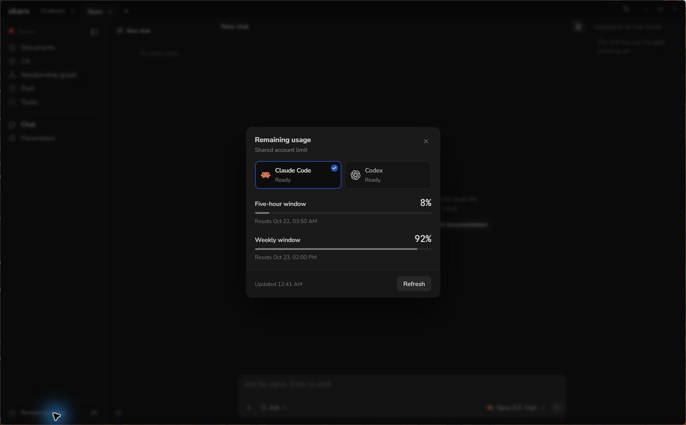
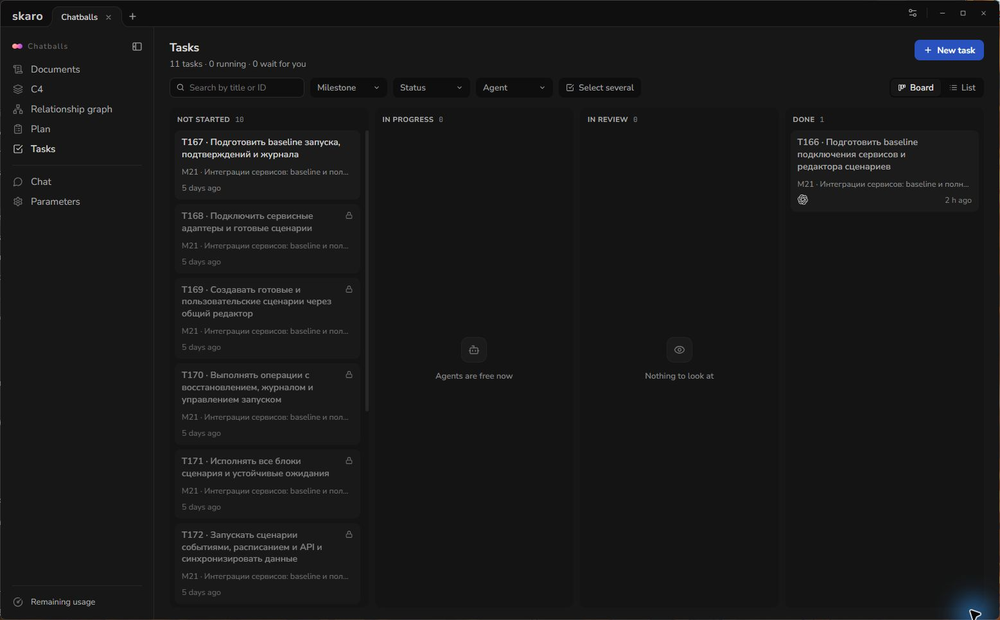

# Troubleshoot Common Problems

Start with the visible error and the step that failed. Installation, agent sign-in, provider limits and project runtime problems need different fixes.

## Skaro does not open

Check that you downloaded the installer for your OS and processor. Re-download an incomplete file from the [official release](https://github.com/dartdavros/skaro/releases/latest).

- **Windows unknown-publisher or SmartScreen warning:** see [Install Skaro on Windows](/articles/install-windows). A managed-device policy or malware detection is a separate issue.
- **macOS unidentified-developer or notarization warning:** see [Install Skaro on macOS](/articles/install-macos). Do not apply the same instructions to every malware or damaged-app alert.
- **Linux AppImage:** check executable permissions, architecture and the error printed by launching it from a terminal. See [Install Skaro on Linux](/articles/install-linux).

## An agent is unavailable or asks you to sign in

Open **Settings → Agents**. Confirm the download completed, use **Sign in** if needed and then **Check again**. Verify that the account can use that agent and model. Complete authentication yourself; do not paste tokens or recovery codes into a support request.

If authorization expired during a conversation, sign in again and retry the next request after the status has refreshed. Existing changes do not need to be deleted to repair sign-in. See [Connect Codex or Claude Code](/articles/connect-agents).

## A provider limit has been reached

Open **Remaining usage** at the bottom of the project sidebar. Select the relevant agent and inspect its reported windows and reset times. Quota is shared with other work on the same provider account, including outside Skaro.

A dash or failed request means the value is unavailable; it is not a measured zero. Reaching a reset time also does not prove quota has replenished until the provider returns an updated value.

## A task will not start

Check the task's dependency lock and whether prerequisites are **Done** and merged. A task may also be waiting for the **Parallel runs** capacity configured under **Settings → Tasks and branches**. Read the displayed reason before changing dependencies or increasing concurrency.

## The task cannot build, test or start the project

A separate worktree has its own working folder. Dependencies, ignored files, environment variables and required services may need the project's documented setup there. Skaro's worktree isolation does not automatically duplicate an external database or resolve port conflicts.

Read the failed command output. Use the real project environment and follow its setup documentation. A missing backend is a runtime blocker, not a reason to mark the task as tested. Retry after the required environment is available.

## Merging is blocked

Read the task feed for overlapping local changes, failing checks, conflicts or unfinished dependencies. Preserve existing work. See [Review and Merge Task Changes](/articles/review-and-merge).

## What to include when asking for help

Open **Settings → About** to find your version and **Export diagnostics**. The export contains technical diagnostic metadata; it does not automatically send a support request. Review any files you choose to share.

Include:

- Your OS version and processor architecture, plus the Skaro version.
- The agent and displayed agent version, if relevant.
- The steps that led to the problem, the expected result and the exact error text.
- A screenshot with secrets, personal account details and private code removed.
- Which checks succeeded, which failed and which could not be run.

Use [GitHub Issues](https://github.com/dartdavros/skaro/issues) for a reproducible bug or [Discussions](https://github.com/dartdavros/skaro/discussions) for usage questions. Do not publish credentials, private repository contents or full chat logs without reviewing them first.
